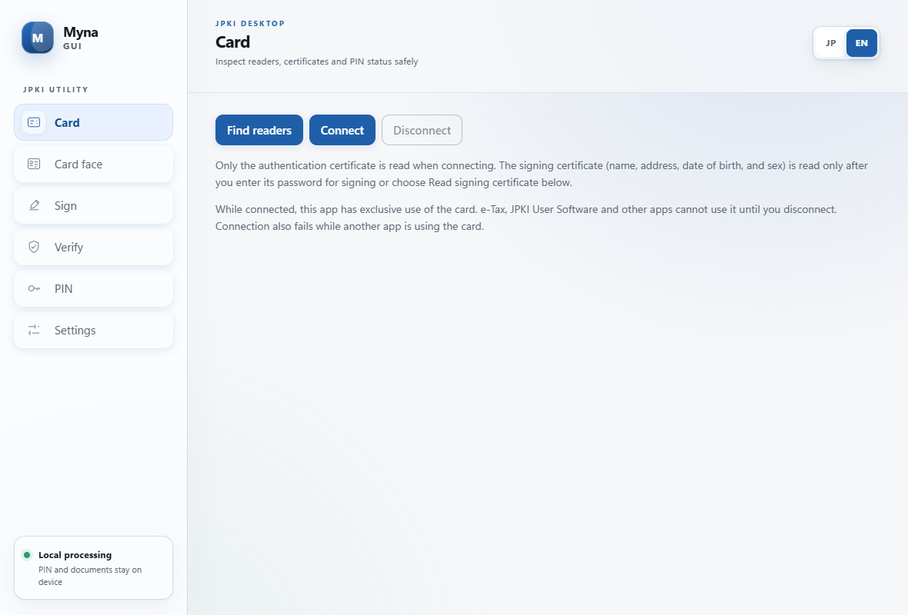

# Myna GUI

[](https://github.com/sdy623/myna-gui/actions/workflows/ci.yml)
[](https://github.com/sdy623/myna-gui/releases)
[](LICENSE)

**Myna GUI is a lightweight, bilingual desktop wrapper for the JPKI features exposed by the
`myna` tool family.** It reads supported data from a Japanese Individual Number Card, reports PIN
retry counters, changes the supported PINs, and signs or verifies files and PDFs.

Myna GUI is unofficial software. It is not provided, endorsed, or certified by J-LIS, Japan's
Digital Agency, a municipality, or any other government body.



## What it does

- Finds PC/SC readers and connects to a physical Individual Number Card.
- Shows the JPKI authentication certificate and CA certificate without requesting a PIN.
- Reads the protected signing certificate and signing CA certificate after explicit password entry.
- Supports the `sign` certificate aliases used by `myna`: `signature` and `digital_signature`.
- Reads the basic four identity attributes, rendered name/address fields, and the card portrait.
  The original JPEG 2000 portrait can be exported; a PNG preview is decoded locally.
- Displays the same seven retry counters as `myna pin status`, without consuming an attempt.
- Changes the card input-helper PIN, JPKI authentication PIN, and JPKI signing password.
- Creates OpenPGP signatures for ordinary files and detached CMS signatures inside PDFs.
- Optionally requests an RFC 3161 timestamp from a selected timestamp authority.
- Verifies OpenPGP and PDF signatures while separating confirmed facts from unchecked claims.
- Provides Japanese and English UI. A `ja` system language selects Japanese; other languages select
  English. A manual JP/EN choice is remembered.

## Relationship to `myna`

This repository preserves and extends the history of
[`soltia48/myna-sign`](https://github.com/soltia48/myna-sign). The card workflow and command naming
follow [`jpki/myna`](https://github.com/jpki/myna), and card access is implemented with the
[`myna-card`](https://crates.io/crates/myna-card) Rust crate.

The GUI maps the main card operations as follows:

| `myna` operation | Myna GUI screen |
|---|---|
| Basic and visual card attributes | **Card face** |
| `jpki cert` for `auth`, `auth_ca`, `sign`, and `sign_ca` | **Card** |
| `pin status` | **PIN** |
| `pin change card/auth/sign` | **PIN** |
| File/PDF signing and verification | **Sign** / **Verify** |

The underlying Rust library and command-line binary retain the name `myna-sign` for compatibility.
The desktop product and installer are named **Myna GUI**.

## Important verification boundary: no revocation lookup

**Myna GUI does not query CRLs, OCSP responders, or the JPKI revocation information service.**

The verifier can check cryptographic signatures, document integrity, certificate validity periods,
key usage, and whether a certificate chains to an embedded J-LIS trust anchor. None of those checks
proves that a certificate has not been revoked. The UI therefore reports revocation as **not
queried** and never collapses all checks into a generic “valid” result.

Formal online JPKI revocation checking is outside this project's scope and may require an authorized
platform-provider service. Do not use Myna GUI where a relying party is required to perform such a
check.

## Privacy and PIN safety

- PINs and documents are processed on the local device. There is no telemetry.
- Timestamping sends only the signature hash to the selected timestamp authority; it never sends
  the source document.
- The Individual Number is used only inside the card-reading flow as verification code A. It is not
  returned to the webview, displayed, or logged.
- PIN/password strings are cleared after use and are not persisted.
- Switching card applications resets cached JPKI signing authorization.
- Card-face data and images remain in memory until cleared, disconnected, or the app exits. Only an
  image the user explicitly exports is written to disk.

### Lockout warning

Incorrect PIN or signing-password attempts are counted by the card. A blocked credential may require
municipal counter service to recover. Myna GUI reads the remaining count first, disables changes for
a blocked credential, and requires an extra confirmation when the count is one or unknown.

## Installation

Windows x64 installers are attached to the
[`v0.9.0` release](https://github.com/sdy623/myna-gui/releases/tag/v0.9.0):

- `Myna.GUI_0.9.0_x64_en-US.msi`
- `Myna.GUI_0.9.0_x64-setup.exe`
- `SHA256SUMS.txt`

The v0.9.0 packages are not code-signed, so Windows may display a SmartScreen warning. Verify the
download against `SHA256SUMS.txt` before running it.

Requirements:

- Windows 10/11 x64 with WebView2
- A PC/SC-compatible smart-card reader
- A supported Japanese Individual Number Card

Do not run JPKI User Software, `certutil -scinfo`, e-Tax software, or another card application at the
same time. PC/SC access is exclusive while Myna GUI is connected.

## Build from source

| Dependency | Minimum |
|---|---|
| Rust | 1.92 |
| Node.js | 20 |
| Windows | Built-in PC/SC and WebView2 |
| Linux | `pcscd`, `libpcsclite-dev`, WebKitGTK 4.1 development packages |
| macOS | System PC/SC and WebKit |

```sh
git clone https://github.com/sdy623/myna-gui.git
cd myna-gui

npm ci --prefix ui
npm --prefix ui run build
cargo test --workspace --locked

# Development
npm exec --prefix ui -- tauri dev

# Desktop application with embedded frontend
npm exec --prefix ui -- tauri build --no-bundle

# Windows installers
npm exec --prefix ui -- tauri build --bundles msi,nsis --ci
```

When building the Tauri application directly with Cargo, the `custom-protocol` feature is required:

```sh
cargo build --release -p myna-sign-app --features custom-protocol
```

Without it, the release binary looks for the Vite development server instead of embedding the UI.

## Command-line tools

The original card-free testing and signing CLI remains available:

```sh
cargo build --bin myna-sign

# List readers and inspect a card
./target/debug/myna-sign readers
./target/debug/myna-sign card

# Exercise the signing pipeline with a disposable software key
./target/debug/myna-sign --soft-key sign contract.txt --public-key
./target/debug/myna-sign verify contract.txt.asc contract.txt
./target/debug/myna-sign --soft-key sign-pdf contract.pdf
./target/debug/myna-sign verify-pdf contract.pdf.signed.pdf
```

A software-key signature only tests the pipeline; it does not prove anyone's identity.

## Tests

```sh
# Unit tests plus GnuPG/pdfsig interoperability where the tools are installed
cargo test --workspace --locked

# Formatting and linting
cargo fmt --all --check
cargo clippy --workspace --all-targets --locked -- -D warnings

# Tests requiring a physical card or live timestamp authority are ignored by default
cargo test --test with_card -- --ignored
cargo test --test interop -- --ignored
```

Automated tests cannot prove reader compatibility, PIN-pad behavior, or successful access to a
particular physical card. Treat those as separate hardware acceptance checks.

## Repository layout

```text
src/              Signing, verification, PC/SC, and the myna-sign CLI
src-tauri/        Tauri desktop application and IPC boundary
ui/               Preact/Vite bilingual interface
tests/            Unit, interoperability, timestamp, and physical-card tests
assets/           Embedded trust material and the bundled Noto Sans JP font
docs/images/      README screenshots
```

## License and attribution

Myna GUI is distributed under the [MIT License](LICENSE). Upstream and third-party attribution is
recorded in [NOTICE](NOTICE).

The bundled Noto Sans JP font is licensed separately under the SIL Open Font License 1.1; its full
license text is stored at `assets/fonts/LICENSE-NotoSansJP.txt` and must remain with redistributed
packages.
